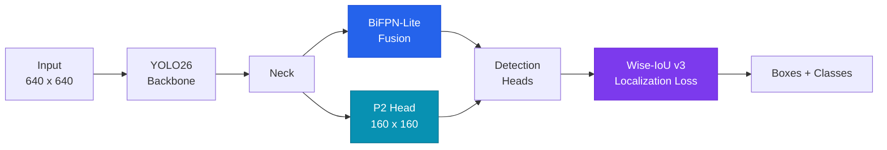

<div align="center">


<br/>

[](https://www.python.org/)
[](https://pytorch.org/)
[](https://docs.ultralytics.com/)
[](https://streamlit.io/)
[](https://github.com/VisDrone/VisDrone-Dataset)
[](#-license)

### Research-grade aerial object detection for tiny, dense and occluded targets

**A deployable YOLO26-L detector trained on VisDrone2019, wrapped in an interactive analytics dashboard, and backed by a systematic ablation study on multi-scale feature enhancement.**

[Overview](#-overview) •
[Features](#-features) •
[Architecture](#-research-architecture) •
[Results](#-results) •
[Quick Start](#-quick-start) •
[Roadmap](#-roadmap) •
[Authors](#-authors)

</div>

---

## 📌 Overview

Drones see the world from far away. At altitude, a pedestrian can shrink to fewer than **16 × 16 pixels**, vehicles bunch together in traffic, and objects occlude each other. General-purpose detectors lose most of this fine spatial detail as features travel through deep backbone layers, so small and crowded objects are exactly where they fail.

**UAV Vision Intelligence** tackles that problem on two fronts:

| | Track | What it delivers |
|---|---|---|
| 🔬 | **Research** | A sequential ablation study that extends YOLO26 with a **P2 high-resolution head**, a **BiFPN-Lite** fusion neck, and the **Wise-IoU v3** loss, and measures what each change actually buys in accuracy, speed and compute. |
| 🛰️ | **Deployment** | A **Streamlit dashboard** that serves the trained detector: upload an aerial image, tune inference parameters, and get annotated output plus structured detection analytics. |

> **Project title:** *Multi-Scale Feature Enhanced YOLO26 for Small Object Detection in UAV Imagery*
> Major Project-I (01IT1703) · B.Tech Information Technology · Marwadi University

---

## ✨ Features

- 🎯 **Small-object focused detection**, trained on VisDrone2019 across 10 aerial object classes
- ⚡ **Real-time capable**: the deployed baseline runs at ~122 FPS on the benchmark GPU
- 🎛️ **Interactive inference controls** for confidence threshold, IoU (NMS) threshold, image size and max detections
- 📊 **Detection analytics**: per-class counts, confidence statistics (mean / min / max) and a structured detection table with bounding-box coordinates
- 🖼️ **Annotated output** with downloadable results
- 🧠 **Auto device selection**: uses CUDA when available and falls back to CPU
- 🧪 **Reproducible research setup**: fixed seed, documented hyperparameters, and a clean ablation protocol
- 🌑 **Premium dark UI** built with custom CSS on top of Streamlit

---

## 🧭 Research Architecture

The research track layers three targeted modifications onto the YOLO26 backbone–neck–head design. Each one answers a specific weakness identified in the literature.



| # | Modification | Problem it targets | Mechanism |
|---|---|---|---|
| **E1** | **P2 detection head** | Fine spatial detail is lost in deep layers | Adds a stride-4 (160 × 160) feature map so tiny pedestrians and vehicles keep a high-resolution representation |
| **E2** | **BiFPN-Lite fusion** | Weak cross-scale feature aggregation | Lightweight bidirectional pyramid with learnable fusion, with no heavy fusion network |
| **E3** | **Wise-IoU v3 loss** | Poor localization of tiny boxes under IoU-style losses | Dynamic, gradient-gain-based loss that improves regression stability and convergence |


---

## 🗂️ Dataset: VisDrone2019-DET

Collected by the **AISKYEYE team (Tianjin University)** across **14 Chinese cities**, under varying altitude, weather and lighting.

| Split | Images |
|:---|---:|
| Train | 6,471 |
| Validation | 548 |
| Test-dev | 1,610 |
| Test-challenge | 1,580 |
| **Total** | **10,209** |

- **10 classes:** `pedestrian` · `person` · `bicycle` · `car` · `van` · `truck` · `tricycle` · `awning-tricycle` · `bus` · `motor`
- **Training set density:** 343,205 annotated objects, an average of **53.04 objects per image** (median ≈ 43)
- **Core challenge:** a large share of instances are below 32 × 32 px, and many below 16 × 16 px (COCO-style *small* < 32 px)

---

## 🚀 Quick Start

### Prerequisites

- Python **3.10+**
- *(Optional but recommended)* an NVIDIA GPU with CUDA for fast inference

### 1. Clone

```bash
git clone https://github.com/Princeg1204/UAV-Vision-Intelligence.git
cd UAV-Vision-Intelligence
```

### 2. Create an environment

```bash
python -m venv .venv

# Linux / macOS
source .venv/bin/activate

# Windows
.venv\Scripts\activate
```

### 3. Install dependencies

```bash
pip install -r requirements.txt
```

### 4. Run the dashboard

```bash
streamlit run app.py
```

Open **http://localhost:8501** in your browser.

### 5. Use it

1. Upload an aerial / drone image (JPG or PNG)
2. Tune the confidence, IoU, image-size and max-detection controls
3. Run detection
4. Inspect the annotated image, class distribution, confidence statistics and the detection table
5. Download the results

---

## 🐍 Use the model from Python

```python
from ultralytics import YOLO

model = YOLO("models/best.pt")

results = model.predict(
    source="your_aerial_image.jpg",
    imgsz=640,
    conf=0.25,
    iou=0.45,
    max_det=300,
)

results[0].show()
```

> 💡 For dense scenes, a larger `imgsz` (for example 960 or 1280) usually recovers more tiny objects, at the cost of speed.

---

## 🏗️ Project Structure

```
UAV-Vision-Intelligence/
├── models/
│   └── best.pt            # Trained YOLO26-L checkpoint (VisDrone2019)
├── app.py                 # Streamlit dashboard: UI, inference and analytics
├── requirements.txt       # Python dependencies
├── .gitignore
└── README.md
```

---

## 🛠️ Tech Stack

<div align="center">


</div>

---

## 🎯 Real-World Applications

| Domain | Use |
|:---|:---|
| 🚦 Traffic monitoring | Vehicle counting and congestion analysis from aerial feeds |
| 🛡️ Surveillance & security | Crowd and perimeter awareness over wide areas |
| 🌊 Disaster response | Locating people and vehicles in flood or collapse zones |
| 🏙️ Smart cities | Urban mobility and infrastructure analytics |

---

## 🧱 Limitations

Being upfront about scope:

- The **deployed checkpoint is the baseline YOLO26-L**. The enhanced variants (E1, E2) are research results, and E3 is still to be trained.
- Detection quality drops for objects under ~16 px and in very heavy occlusion.
- Results are on the VisDrone **validation** split, so they should not be compared directly with test-split numbers from other papers.
- The dataset covers Chinese urban scenes, so generalization to very different environments is untested.

---

## 👥 Authors

<div align="center">

| | Role | Links |
|:---|:---|:---|
| **Prince Gajera** | Co-author · Model training, ablation study, deployment | [GitHub](https://github.com/Princeg1204) · [LinkedIn](https://linkedin.com/in/princegajera/) |
| **Smit Chauhan** | Co-author | |
| **Dr. Damodharan Palaniappan** | Project guide | |

**Department of Information Technology · Marwadi University, Rajkot, Gujarat, India**

</div>

---

## 📚 References

1. G. Jocher et al., *Ultralytics YOLO26*, Ultralytics Documentation, 2026. <https://docs.ultralytics.com/models/yolo26>
2. P. Zhu et al., "Detection and Tracking Meet Drones Challenge," *IEEE TPAMI*, 2021. (VisDrone dataset)
3. M. Tan, R. Pang, and Q. V. Le, "EfficientDet: Scalable and Efficient Object Detection," *CVPR*, 2020. (BiFPN)
4. Z. Tong, Y. Chen, Z. Xu, and R. Yu, "Wise-IoU: Bounding Box Regression Loss with Dynamic Focusing Mechanism," arXiv:2301.10051, 2023.

---

## 📝 Citation

If this work helps your research, please cite:

```bibtex
@misc{gajera2026uavvision,
  title        = {Multi-Scale Feature Enhanced YOLO26 for Small Object Detection in UAV Imagery},
  author       = {Gajera, Prince and Chauhan, Smit},
  year         = {2026},
  howpublished = {\url{https://github.com/Princeg1204/UAV-Vision-Intelligence}},
  note         = {Major Project-I, Department of Information Technology, Marwadi University}
}
```

---

## 🙏 Acknowledgements

- **AISKYEYE team, Tianjin University** for the VisDrone dataset
- **Ultralytics** for the YOLO framework
- **Dr. Damodharan Palaniappan** for guidance throughout the project
- **Marwadi University**, Department of Information Technology

---

## 📄 License

Released under the **MIT License**. Add a `LICENSE` file to the repo root to make this official. Note that the VisDrone dataset and the Ultralytics framework carry their own licenses and terms of use.

---

<div align="center">

**If this project helped you, consider giving it a ⭐**

*Built with 🛰️ and a lot of GPU hours by [Prince Gajera](https://github.com/Princeg1204)*


</div>
